# leader

A leader harness for coding agents, built on [agent-deck](https://github.com/asheshgoplani/agent-deck). One agent session becomes the leader: it splits a task, hands each piece to a worker session running a harness and model you chose, checks what comes back, and writes a grade to a ledger. Over time the ledger shows which harness and model is good at which kind of work.

**TL;DR** Hand this repo to your agent and let it set itself up:

```
Set up https://github.com/ckjeter/leader-in-agent-deck for me. Follow its ONBOARD.md.
```

It installs the skill, asks what you have, and writes a roster that fits. After that, start any task with `/leader`.

This is a personal project and is not part of agent-deck. agent-deck does the heavy lifting: it starts the worker sessions, carries messages between them, and keeps every worker visible as a terminal pane you can open and read.



## The loop

1. **Split** the task into pieces and give each a class: `impl`, `review`, `research`, `bulk`, `read`, `write`.
2. **Launch** a worker for each piece with a written brief. The roster says which harness and model goes first for that class.
3. **Wait** for the worker to finish, hit a limit, or ask a question.
4. **Verify** the result. If it needs fixing, send it back to the same worker while its context is warm.
5. **Log** a grade from 1 to 3 to the ledger, including the pieces the leader did itself.

The leader is an ordinary agent session with a skill loaded, so it keeps full capability. It delegates when a brief is cheaper than doing the work, and does the rest itself.

## What agent-deck gives it

- **Sessions talk to each other.** A brief goes out as a message, a follow-up goes to the same worker, and a worker that is blocked can ask its leader a question. Nothing is hidden inside one harness's private subagents.
- **Handoffs are files.** Every run has a folder with `brief.md`, `result.md` and each follow-up, so another session, or you, can pick a piece of work up from what was written down.
- **Mixed harnesses.** Claude Code, Codex and pi workers sit side by side in the same group, launched the same way.
- **More than one machine.** See below.

## Across machines

This is how I run it. Each machine has agent-deck, and they are joined with `agent-deck remote add <name> <user@host>`. I recommend [Tailscale](https://tailscale.com/) for the network between them, so every host is reachable by name without opening ports.

With that in place a leader is not tied to the machine you are sitting at. From one deck you can open a leader on any host, message it, read its output and hand work from a session on one machine to a session on another. Each leader launches its workers on its own host, next to the code it is working on. Each host writes its own ledger file, so ledgers from several machines merge by concatenating them.

## Quickstart

You need agent-deck working first, with at least one agent CLI it can launch. [ONBOARD.md](ONBOARD.md) is the same setup written for an agent to follow. By hand:

```sh
git clone https://github.com/ckjeter/leader-in-agent-deck ~/.claude/skills/leader
mkdir -p ~/.config/leader
cp ~/.claude/skills/leader/roster.example.toml ~/.config/leader/roster.toml
uv run ~/.claude/skills/leader/scripts/leader.py health
```

`health` should print `"mode": "normal"`. The example roster lists more workers than most people have. Workers whose CLI is not installed are marked `available: false` and the leader skips them, so it runs as is with only Claude Code. A CLI that is installed but has no access to a listed model still fails at launch, so remove the workers you cannot run. Then start a Claude Code session through agent-deck and type:

```
/leader add retry with backoff to the fetch client, with tests
```

For Codex and pi, clone into `~/.agents/skills/leader` instead and ask the agent to run the task in leader mode.

Asking in plain words works too. An agent may also suggest leader mode on its own for a large task, but the skill tells it to describe the split and wait for your yes before it launches anything.

## The roster

`roster.example.toml` is close to the lineup I run. It records what I chose to try and why, not a verdict on any model. The rules behind it:

- Subscriptions I already pay for do most of the work.
- The strongest model stays on the leader.
- The same model appears under two harnesses on purpose, so the ledger can tell the model from the harness.
- Models I am only curious about get no default slot. A fixed share of dispatches (`exploration_share`, 20% by default) goes to non-default workers, so trying them is cheap and still gets measured.

## The ledger

One JSON line per piece of work, in `~/.local/share/leader/ledger/<host>.jsonl`. The rows below are invented for illustration and shortened. The full format is in [references/ledger-v1.md](references/ledger-v1.md).

```json
{"v":1,"type":"dispatch","id":"20260301-101502-a1b2","host":"laptop","route":"delegate","via":"agent-deck","worker":{"id":"codex/gpt-6.1-sol","pool":"codex"},"class":"impl","task":"Add retry with backoff to the fetch client","why":"default for impl, Claude window at 85%","explore":false,"verify":"tests pass, read diff","outcome":"done","grade":2,"rework":"jitter was missing","followups":1}
{"v":1,"type":"dispatch","id":"20260301-101733-c3d4","host":"laptop","route":"delegate","via":"agent-deck","worker":{"id":"pi/deepseek-v4-pro","pool":"opencode-go"},"class":"review","task":"Review the retry change for races","why":"exploration slot, low risk","explore":true,"verify":"checked both findings by hand","outcome":"done","grade":3,"rework":null,"followups":0}
```

`leader roster --class impl` reads the ledger back next to the roster, so the next routing decision sees the record:

```json
"codex/gpt-6.1-sol": {
  "pool": "codex",
  "note": "Second in line for implementation",
  "ledger": {"impl": {"n": 12, "mean_grade": 2.58, "failed": 1, "abandoned": 0}}
}
```

Once a worker has about ten rows in a class, its numbers count for more than the note.

The ledger holds only what the leader knows: why a worker was picked and how good the result was. Tokens, cost and duration are left to whatever reads the harness transcripts.

## Not built yet

- **Roster upkeep.** [ONBOARD.md](ONBOARD.md) gets an agent to write your first roster. Nothing keeps it current yet when models, CLIs or subscriptions change.
- **Usage for every pool.** The leader routes around a pool that is running low, but today it can read remaining usage only for Claude. Reading the other pools would make that routing decision better informed.

## Requirements

- [agent-deck](https://github.com/asheshgoplani/agent-deck). Developed against v1.16.
- [uv](https://docs.astral.sh/uv/) and Python 3.11 or newer. The helper uses only the standard library.
- At least one worker CLI that agent-deck can launch: `claude`, `codex` or `pi`.

## Known limitations

- **A new folder stops at the trust prompt.** Launching a Claude Code or Codex worker into a directory that CLI has never opened waits on its "trust this folder?" prompt. `launch` can time out and the brief may not be delivered. Open the folder once with that CLI first, or accept the prompt in the worker's pane and resend the run's `brief.md` with `agent-deck session send`.
- **A full group queues the worker, and `launch` reports a failure.** When the agent-deck group is at its concurrency cap the session is queued. `launch` then exits with an error, and `send` and `wait` refuse that run. The session id is still in the run's `meta.json`. Watch that session yourself and read `result.md` when it appears.
- **A queued Codex session can start without its brief.** Resend `brief.md` to it once it is running.
- **A message sent to a busy Codex pane can sit typed but unsent.** It goes through when Tab is pressed in the pane. Send follow-ups after the worker has stopped.
- **On macOS the ledger file name can drift.** The ledger is named after `hostname -s`, and a Mac reports different short names on different networks. Each new name starts a new ledger file, so the stats split. Map every name your Mac reports to one short name under `[hosts]` in the roster, or set `LEADER_HOST`.
- **Classes are fixed.** `leader log --class` accepts the six classes above and nothing else, so the stats stay comparable.
- **Claude is the only usage gauge.** `health` shows subscription windows only where agent-deck can read them.

## Contributing

See [CONTRIBUTING.md](CONTRIBUTING.md). The short version: one problem per pull request, a test that fails without your change, and `sh scripts/check.sh` before you open it. Never post raw ledger rows or briefs, since they contain your paths and task text.

## License

MIT. See [LICENSE](LICENSE).
